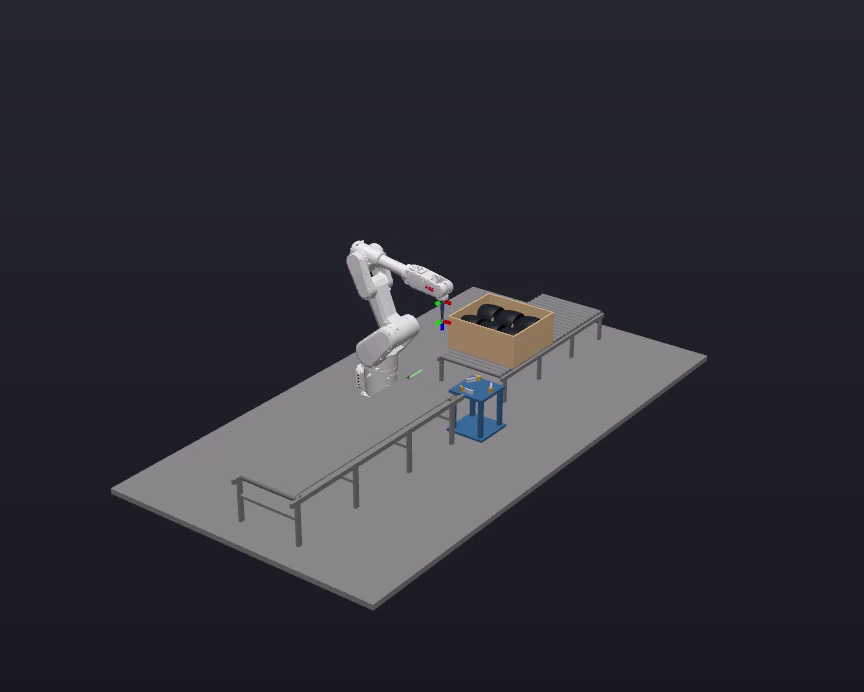

# Workbench cell

A RobotStudio workcell transfers elbow pipes from an infeed belt to an interim fixture, changes the vacuum contact point, and places the pipes in a box. Simulated vision measures each pipe’s position for the pickup. The cell uses an IRB 1300 robot with an OmniCore virtual controller.

The infeed conveyor is **1.8 m long**, with a **1.62 m flat belt**. The box rests on a visible stationary roller conveyor. Robot motion speed settings are 16 times those of the previous version.

**Verified on the source cell:** six distinct pipes reached slots 0–5 through both pickup contacts and the interim fixture. The run recorded 24 pickup and placement events, six error-free cycle rows, and a normal stop. Mean recorded handling cycle: **17.605 s**. On the first pipe’s straight approach, sampled speed was approximately **320 mm/s**, compared with **20 mm/s** in the previous run; this measurement covers that segment only.

[Watch the complete run](Demo/q7n4-full-run.mp4) · [Cycle data](RunData/cycles.csv) · [Run summary](RunData/run_summary.json)

## Run

Use RobotStudio 2026 on Windows. Close the previous copy’s virtual controller before restoring another copy. Restore `Native/q7n4-workcell.rspag` into an empty directory, install `RuntimePackage/q7n4-runtime-0.15.0.rspak`, and restart RobotStudio when requested. Open the restored initial station and select **Prepare and Run (6 parts)**. See [usage](USAGE.md).

A second six-part run also completed on a separately restored Pack & Go station and virtual controller, using the supplied runtime DLL directly. The add-in package has been built and its contents checked; installation through RobotStudio’s package interface and toolbar registration have not been tested for this version.

## Files

- `Native`: official Pack & Go station.
- `RuntimePackage`: installable RobotStudio add-in package.
- `Runtime014`: companion runtime and geometry assets.
- `Source`: editable source and build instructions.
- `Demo` and `RunData`: run video, scene image, cycle data and placements.
