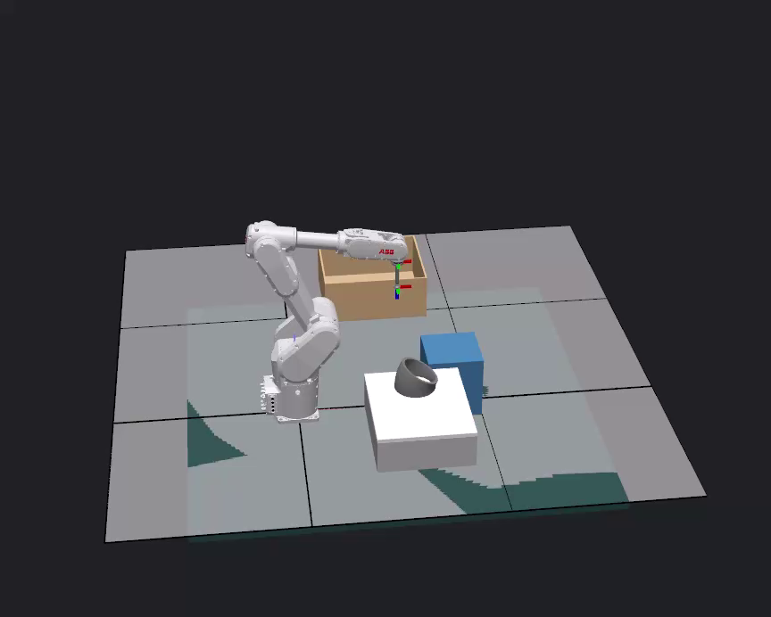

# q7n4-runtime

RobotStudio workcell for vacuum pickup, interim fixture release, second-contact regrasp and indexed packing.

## Download and run

[Runtime packages and full demonstration video](https://github.com/zzy2670/q7n4-runtime/releases/tag/v0.13.3)

1. Install RobotStudio 2026.3, RobotWare 7.15.4, the official IRB1300 model package 2.8 and an appropriate simulation license.
2. Install the `.rspak` add-in from the Release, then restart RobotStudio as prompted.
3. Restore the `.rspag` through **File → Share → Unpack & Work** into a new empty folder, using the included libraries and controller backup.
4. Wait for the virtual controller to connect, then press **Prepare & Run Demo** once. The demonstration processes twenty parts and takes approximately 27 minutes.

[Run and build instructions](USAGE.md)

## Project files

- `source/`: RAPID, add-in and material-handling source, tests and frozen runtime inputs.
- `cad/`: workpiece, vacuum tool and cell geometry.
- `evidence/`: original run results, controller CSV and recording metadata.
- `delivery/`: runtime identity and acceptance records.
- `tools/`: recording validation utility.

The Release supplies the native workcell, add-in, full MP4 recording and raw run data. Validate downloads with `SHA256SUMS.txt`.

Vacuum is an ideal attachment model. Real suction capacity, hardware accuracy and continuous swept-volume clearance require separate validation.
